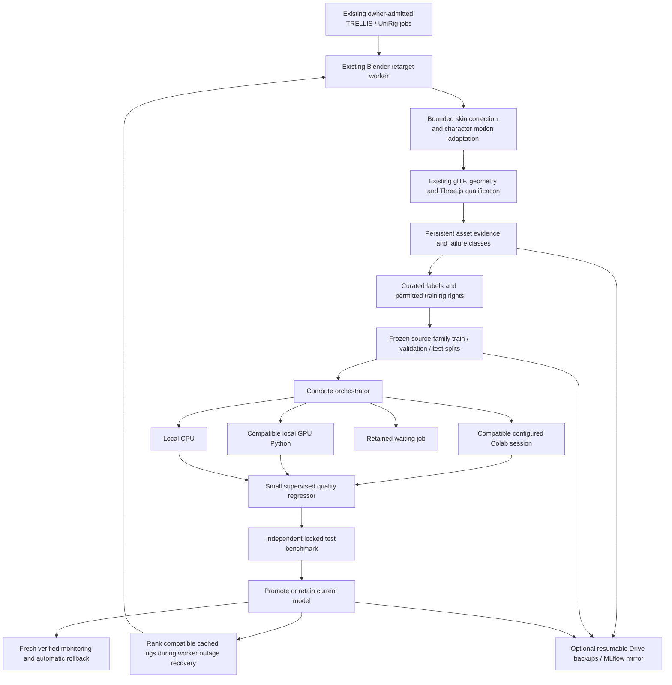

# Asset pipeline V3 foundation — 2026-10-21


## Failed source quality follow-up (2026-10-21)

The owner's Wukong screenshot (seed 1549893872) is a failed character reconstruction, despite successful Colab execution. The hybrid bridge's neural generator is Shap-E, not TRELLIS. Earlier connectivity and container checks must not be read as visual acceptance.

Fixed an invalid concept-image texture assignment without UV coordinates, aspect-distorting input resize, and stale remote worker synchronization. New exports use their actual generated vertex colors and carry model/seed/visual-review provenance; bridge validation rejects the original texture defect. Nine targeted tests pass. The actual failed source has one standard glTF error; an isolated export-only diagnostic has zero errors/warnings. The diagnostic preserves the geometry and is still visually unacceptable. No source replacement, publication or successful regeneration is claimed. A working generator must demonstrate recognizable anatomy and reference fidelity before rigging this character.

## Live Colab verification follow-up

The existing `asset-quality` session now executes successfully from the host and
the deployed avatar worker. Live capacity reports Tesla T4, 14,807 MiB free VRAM,
Python 3.13 and torch CUDA 13.0. The repository quality-training adapter completed
a synthetic connectivity test without promoting a model or adding training labels.
See `colab-connectivity-verification.json` for the scoped results.

The optional `compose.avatar-cloud.yaml` overlay adds the verified Colab CLI
0.7.5 and Python 3.12 to the avatar worker and shares the existing authenticated
host Colab config directory. Its default path can be overridden with
`ASSET_COLAB_CONFIG_DIR`. Existing GPU engines and Blender's embedded Python are
unchanged. Build/start only the idle avatar worker:

```bash
docker compose --env-file .env.evolution.local -f compose.evolution.yaml \
  -f compose.evolution.dev.yaml -f compose.avatar-cloud.yaml build avatar-worker
docker compose --env-file .env.evolution.local -f compose.evolution.yaml \
  -f compose.evolution.dev.yaml -f compose.avatar-cloud.yaml up -d --no-deps avatar-worker
```

The adapter now isolates its worker definitions and restores stdin after each
remote call, so it can share the kernel with other work. The dedicated generation
bridge was inspected independently; this connectivity check did not generate a
new 3D asset or verify the artistic quality of neural output.

Local follow-up also built/started the pinned Blender worker and tested restart
persistence. An authored Dawnna-derived fixture passed geometry, skin, animation,
glTF-error and actual Three.js playback checks, but foot-contact drift regressed
from 2.76835 to 4.96153. It therefore remains `needs_improvement`; it was not
published or accepted as improved generated-character evidence. The actual
generated Dawnna sources were absent from this host. Diagnostic fixtures are
explicitly excluded from training collection.

The previous environment-sensitive Laravel reference test now has an explicit
temporary missing-reference fixture. All 125 backend tests passed before the
independent generation-bridge changes appearing concurrently in the workspace.
The pinned Blender's 18 contact/joint/mesh tests and the worker's 31 asset-pipeline
tests passed. Historical limitations below describe the initial foundation state.

This increment upgrades the existing avatar worker. It implements persistent
compute scheduling, optional Drive storage, technical/visual-feature evaluation,
verified-data training, model comparison/rollback and motion adaptation. It is
**not completion of every phase of the master prompt**. Live cloud credentials,
engine installations, curated ratings and actual Blender/Three.js asset runs are
still required to establish production quality.



## Repository audit and integration

- Existing stack: Laravel/PostgreSQL owner controls and queues; Node 24 avatar
  worker; Blender 4.5.3 headless; React 19/Three.js 0.186 native clip playback.
  TRELLIS uses isolated Python 3.12, torch 2.9.1/cu128; UniRig uses Python 3.11,
  torch 2.5.1/cu124. Their pinned images/checkpoints are unchanged.
- New package: `infrastructure/avatar-evolution/asset_pipeline`. It uses Python
  standard library by default. Like the existing evolution runner's operations
  ledger, its SQLite WAL database lives on a durable worker volume. Laravel's
  PostgreSQL database continues to own jobs, reports and releases exposed by the
  app; this worker ledger does not replace it or mirror those deleted histories
  back into the application.
- `server.mjs` starts a single bounded coordinator tick every minute, and exposes
  cached status through the existing authenticated `/operations` response and
  `/asset-intelligence`. `preparation-job.mjs` collects terminal evidence; scans
  recover interrupted collection. The existing enhancement dashboard displays
  reviewed/uncertain examples, queue, cloud configuration and model benchmark.
- `preparationEngine()` hashes the new implementation files. New development
  mounts are in `compose.evolution.dev.yaml`. A worker rebuild/restart is needed
  to use this change; no avatar worker was started or model published here.
- The present host is Python 3.12.3 / Node 24.13.0. Docker inspection found no
  running avatar/TRELLIS/UniRig worker and no avatar-worker image. Host torch,
  CUDA tools, Blender, mathutils, Colab CLI and MLflow are unavailable. Historical
  RTX 3060 compatibility in the repository is not current GPU evidence.

## Compute configuration

Run commands from `infrastructure/avatar-evolution`:

```bash
python3 -m asset_pipeline.cli --root /tmp/asset-pipeline status
python3 -m asset_pipeline.cli --root /tmp/asset-pipeline tick /path/to/avatar-data
python3 -m unittest test_asset_pipeline test_bone_mapping test_skin_pipeline -v
```

In the normal worker, data defaults to `/avatar-data/intelligence`. The existing
avatar volume is retained. `cloud.env.example` lists optional settings; compose
passes these values to the worker. The operator must separately mount private
credential files and optional environments. Do not put credentials in that example.

Jobs declare identity, dependencies, priority, Python/environment identity, CUDA,
accelerators, minimum VRAM, estimated RAM, runtime/retry budget, model/pipeline
versions, input/output references and checkpoint compatibility. Registered
handlers alone may execute. Claims use database transactions and lease tokens;
late executors cannot commit after their lease is replaced. Resource mismatches
consume no attempts. Retry backoff is bounded; unavailable GPU work does not
starve CPU work. Local subprocesses have deadlines. An exclusive tick lock
prevents duplicate coordinator cycles.

Only `quality_train` is registered in this increment. Existing TRELLIS/UniRig
generation remains on its proven workers and resource controls. Do not infer
cloud generation support from the presence of compute provider classes.

Install optional extras in a separate Python 3.12+ environment using
`requirements-cloud.txt` (`google-colab-cli==0.7.2`, `mlflow-skinny==3.5.1`). These
extras were not installed/tested live during this change. The default avatar
image's system Python can run collection and ridge training without them.

### Colab

Use the official [Colab CLI](https://github.com/googlecolab/google-colab-cli).
Authenticate using its documented ADC or OAuth flow; account authentication and
runtime GCP authentication are separate operations. Provision and manage a session
with the CLI, then configure the coordinator with that session name:

```bash
colab new -s asset-quality --gpu T4
colab exec -s asset-quality
```

In that authenticated session, certify the stdlib worker environment:

```python
import os
os.environ['ASSET_ENVIRONMENT'] = 'asset-quality-stdlib-v1'
```

Set `ASSET_COLAB_SESSION=asset-quality` in the coordinator environment. The
provider probes the live runtime via `colab exec -s`; Python versions, RAM,
torch CUDA and available VRAM are compared against the job contract. The stdlib
learner permits Python 3.11/3.12/3.13. The adapter
submits a self-contained source program and frozen training/validation data over
stdin, reading a structured result marker. Test labels never leave the coordinator.
It creates no permanent server, tunnels or keepalive mechanism. A configured
session is operator-managed; stop it with `colab stop -s asset-quality` when done.
The coordinator does not allocate new billable sessions automatically.

Set `ASSET_LOCAL_GPU_PYTHON` to an installed, qualified Python executable to
enable the local GPU probe/handler. The probe runs in that interpreter and reads
actual torch CUDA capability. The tiny ridge learner does not benefit materially
from GPU acceleration; unsupported generative GPU jobs stay on existing workers.

## Google Drive setup and recovery

Enable Drive API in an operator-owned Google Cloud project. Complete the normal
OAuth consent flow with the narrow `drive.file` scope, using an installed-app
OAuth client and offline access. Keep the resulting token file outside source
control, mount it privately, and set `ASSET_DRIVE_TOKEN_FILE` to its container
path. Its schema is:

```json
{
  "client_id": "<OAuth client ID>",
  "client_secret": "<private OAuth client secret>",
  "refresh_token": "<private offline refresh token>",
  "access_token": "<private access token>",
  "expires_at": 0,
  "scopes": ["https://www.googleapis.com/auth/drive.file"]
}
```

Mount its containing private directory as writable so atomic refresh can replace
the token file (a single read-only secret/file mount cannot refresh). Set
restrictive file permissions. The refresh writer uses private temporary
files and atomic replacement. `ASSET_DRIVE_PARENT_ID` optionally selects an
app-accessible folder. Stable generated file IDs, source SHA-256 and server MD5
are recorded and verified. Completed artifact versions are immutable. Upload
session URIs persist in the ledger; resume queries recover the accepted offset.
Downloads retain partial files, validate byte ranges and verify final SHA-256
before installing a cache entry. Redirects cannot move bearer credentials to
another origin. Retries and network timeouts are bounded; secrets are not logged.

Ticks back up one preparation artifact or dataset/model artifact at a time.
Inputs remain on local storage if cloud synchronization fails. Missing prepared
candidates, local raw rigs and frozen prepared baselines can recover through the
cache without regenerating their meshes. Recovery requires that the exact
version was previously backed up and its ledger record remains available:

```bash
python3 -m asset_pipeline.cli recover '<preparation-uuid>:candidate-01.glb' '<sha256>'
```

Back up the ledger itself with the host's normal consistent SQLite backup
procedure; Drive file content alone does not reconstruct metadata. Original
TRELLIS reference/source admission, published HTTP serving, equipment storage,
and raw-source recovery are not migrated by this increment. No Drive URL is a
production asset endpoint. Cloud retention/quota pruning is not yet implemented.

## Quality and learning contract

The evaluator consumes real qualification reports and renderer measurements:

| Feature | Meaning / scale |
| --- | --- |
| skeleton_failure | Skeleton gate failed (0 or 1) |
| unweighted / weight_errors | Counts clipped to [0,1] at 100 affected vertices |
| gltf_errors | Validator errors clipped at 10 |
| intersection_growth | Posed minus bind intersection count, clipped at 1,000 |
| foot_drift / hand_jump | Relative regression from the same frozen renderer baseline |
| render_regression | Relative local frame-cost increase, clipped at 100% |
| silhouette_clipping / silhouette_readability | Fractions failing existing studio/gameplay silhouette checks |

Front/side/back and idle/attack/ability silhouettes are required for complete
quality evidence. Existing eight-angle/pose preview images remain available in
the report. These measurements flag framing, missing geometry/readability and
clipping evidence; they do not measure professional artistic quality. No pixel
embedding model or curated image critic has been trained here.

Technical passes are **uncertain**, never automatic positive labels. Incomplete
measurements cannot be labeled for training. Failed assets retain failure classes
and suggested least-cost correction tasks. A local curator can record an actual
review score and permitted training rights:

```bash
python3 -m asset_pipeline.cli label '<example-id>' --score 82 \
  --source human_review --rights commercial_training_permitted
```

`human_review`, `curated_reference` and `verified_correction` are the only accepted
label sources. The operator is responsible for verifying rights. Exact source
revisions/seeds stay in the same hash-based split, with one sample per family.
Near-duplicate **different source meshes** still need a curated source-family
assignment at ingestion; there is no learned geometric deduplication yet.

Training requires 30 independent training families, eight validation and eight
locked test families. Snapshot contents are immutable and hashed. A deterministic
ridge regressor is fitted on training labels and regularization selected on
validation data. No unchanged snapshot retrains. Subsequent training waits for
20 new verified examples relative to the champion snapshot. This lightweight
solver is bounded and repeatable; long-running gradient training, mixed precision,
gradient checkpoints and generative-model training are not implemented here.

Promotion recomputes test metrics locally rather than trusting a candidate's
claimed metrics: at least 0.5 rating-point mean absolute-error improvement,
positive lower paired bootstrap confidence bound, no archetype mean regression
over one rating point, finite/schema-compatible coefficients and prediction
latency within budget. Baselines and previous champions remain available.
Fresh verified families can trigger automatic rollback. Small archetype coverage
and repeated use of one locked suite still warrant curated benchmark expansion.

The learned model influences actual compatible cached-rig selection during
existing UniRig outage recovery. All selected rigs still retarget and requalify.
Predictions never override hard failures or publish assets. Synthetic fixtures
prove ranking and model lifecycle behavior; they are not a measured quality
improvement on the user's character roster. Such a claim requires reviewed real
examples and paired output evaluation.

Set `ASSET_MLFLOW_TRACKING_URI` for an optional MLflow experiment/registry mirror.
It logs model artifacts, locked benchmarks, source snapshot, versions and aliases.
The server needs its own database-backed registry and artifact storage, as
specified in the [MLflow documentation](https://mlflow.org/docs/latest/ml/model-registry/workflow/).
Local promotion/rollback remains available if MLflow is offline. This is a native
JSON quality-model artifact, not an MLflow pyfunc serving deployment. Live
MLflow transport remains unverified here.

## Motion, deformation and rig candidates

`motion_intelligence.py` chooses donor-preserving heavy, staff, short-blade,
sword/shield and ranged adaptations using equipment, authored/heuristic mass,
length, measured arm proportion and shoulder width. Gains are bounded; carrying
calibration, source clip duration and game timing remain intact. Nominal combat
event phases are exported as **presentation metadata**, not new mechanical hits.
Existing runtime attack/ability events remain authoritative. Creature profiles
without compatible donors are explicitly refused.

`DeformationCorrectionEngine` wraps existing rigid-equipment and topology-based
skin repair with before/after validation, one bounded attempt and rollback when
measured weight defects worsen. It exports normal skin weights. It does not
claim to solve shoulder volume, clothing penetration, corrective morph targets
or learned deformation. Those continue through existing geometry/runtime checks.
Qualification now checks invalid weights before filtering tiny influences and
rejects nonpositive/nonfinite clip durations.

`AutoRiggingOrchestrator` compares **provided, stress-tested** rig candidates,
retaining backend/seed/version/scores and selecting only compatible passing
results. It does not launch SkinTokens or multi-seed GPU contests yet. Existing
UniRig remains admitted. The upstream [SkinTokens README](https://github.com/VAST-AI-Research/SkinTokens)
now documents TokenRig models and transfer-preserving CLI inference; its code MIT
license alone does not settle all training/checkpoint/third-party rights.

[MDM](https://github.com/GuyTevet/motion-diffusion-model) remains research-only in
this repository. Its authors explicitly distinguish the code license from
dependency and dataset licenses. No MDM checkpoint or motion dataset was
downloaded, enabled commercially or claimed retarget-compatible.

`evaluate_vfx()` validates provided class/timing evidence offline. VFX generation,
effect learning, event capture and runtime synchronization beyond the existing
game implementation remain future work.

## Verification and remaining deployment work

- All 55 Python failure-injection and existing mapping/skinning tests pass. Cloud HTTP
  and CLI transports use fakes; the transmitted Colab program and local model
  training execute as real Python subprocesses.
- `npm run check:game` and `npm run build` pass. Build retains its existing large
  bundle advisory. No gameplay modules, stats, decisions or RNG were edited.
- Laravel full suite: 124 passed, one failed because the existing
  `test_missing_or_unknown_avatar_reference_cannot_generate` fixture attempted to
  call unavailable `trellis-worker` for `c_kyumi`. The focused avatar suite passes
  all 10 tests / 71 assertions. Blade compilation passes.
- No real character was generated, retargeted, benchmarked or published during
  this change. Blender/material/Three.js end-to-end acceptance of newly adapted
  assets remains required. No new services or cloud sessions were started.

Restart the updated worker only between jobs, then inspect authenticated status,
configure private cloud credentials/session if wanted, collect curated real
examples and run paired asset qualifications. Do not confuse a successful
coordinator/test cycle with commercial character quality or completion of the
remaining GPU engine, dataset, visual critic and VFX phases.
