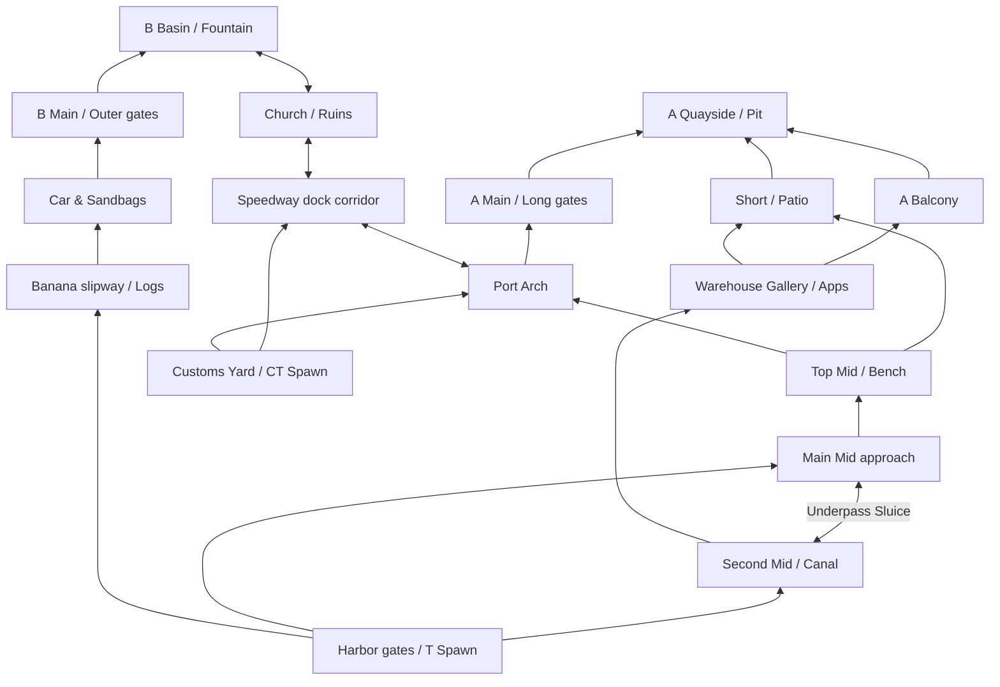

# Three-lane map, movement, executes and team economy

Owner requested applying the supplied tactical-map guidelines and completing the proposed movement/peeking, coordinated execute and shared economy work on 10 November 2026. `/root` owns this pass; no agents or character-asset stages were dispatched. This changes the browser-local exhibition to `hexatrick-live-exhibition-v3` with `breakwater-live-v3`. It does not replace official contextual simulation v3 or historical allocations/replays.

## Adopted map rules

Use three core routes: A lane, continuous Mid approach/cross and B lane. Mid control opens a split into either site and exposes the player to multiple routes. Give defenders a setup window, while site rotations should cost roughly 10–15 seconds at normal run speed. Break long alleys with doglegs and cover; stagger site angles so players can check them sequentially. Standardize key choke widths for one smoke. Keep roofs clean and predictable for utility, sight backgrounds muted, floors free of tiny snagging props and areas visually distinct. Provide solid post-plant cover and multiple retake paths. Future verticality must be readable and intentional. Movement abilities and their special ledges are not part of this original FPS's current rules.

Current topology (Inferno-inspired non-linear tactical structure):

`fpsLiveMap.ts` implements this non-linear Inferno layout:
- **Banana Slipway**: Curved approach with timber Logs cubby, freight Car, and Sandbag bastion before entering B Basin.
- **Mid, Second Mid & Underpass**: Two parallel mid lanes linked by the transverse Underpass Sluice tunnel at `z: -10`, giving AI deep outbraining options (fakes, lurking, cut-offs).
- **Warehouse Gallery (Apps)**: Covered route emerging into A Balcony and Short.
- **A Quayside & Pit**: Open courtyard featuring deep Pit revetment for anchor defense, central crates, and back-site Graveyard.
- **B Basin & Central Fountain**: Centered octagonal stone Fountain with reflective water pool and circular red brick paving for clutch post-plant duels.
- **Speedway & Port Arch**: North rotation corridor connecting CT Spawn across to Church (B) and Arch/Library (A).

Deterministic shortest-path baselines at 4.1 metres/second, excluding acceleration, peeks, fights, utility and deliberate slow play:

| Route | Seconds |
| --- | ---: |
| A plant area → B plant area | 11.51 |
| Attacker spawn → A main choke | 13.41 |
| Defender spawn → A plant area | 7.66 |
| Attacker spawn → B main choke | 12.06 |
| Defender spawn → B plant area | 7.54 |

Thus the geometric setup lead before main-choke contact is about 5.75 seconds at A and 4.52 at B. These are route baselines, not forced travel timers or a balance certification. Live players can arrive later because of their choices and encounters. The map remains flat; readable playable elevation is unfinished.

Lane paving, ground callouts, desaturated A/Mid/B palettes and flat roofs are rendered from the current map in `fpsLiveScenery.ts`. Roof vents were removed so decorative hardware cannot misrepresent bounce blockers. Architecture casts ground shadows but does not receive patterned self-shadowing that obscured player backgrounds. Mobile roster positioning was adjusted after screenshot review.

## Movement and peeking

`fpsLiveMovement.ts` implements velocity with finite acceleration and braking. Run speed is 4.1 m/s and quiet walk speed is 1.65 m/s. Mechanics influences braking execution; existing skills still influence aim/reaction under pressure. The AI waits for weapon-appropriate settling speed before a deliberate shot; it can still execute imperfect moving shots at the permitted speed with a continuous movement-spread penalty. SMGs tolerate more motion than rifles/sniper rifles. No persona changes acceleration or weapon damage.

`fpsLiveSimulation.ts` uses that velocity for route movement, firing-lane sidesteps, cover movement and stopping before plant/defuse channels. A remembered threat behind cover can cause an actual short out-and-back jiggle peek into a collision-clear point. Angle-clearing pauses turn the player's real forward vision toward successive nearby map corners; they do not reveal unseen opponents. Physics, collision and the existing vision sensor still determine whether an enemy is exposed. A reached entry waypoint advances to the site regardless of its absolute Z coordinate, including the lower outer A entry.

Running produces periodic AI-audible footsteps; walking below the threshold does not. Walls attenuate the audible radius, and sound produces uncertain contact positions moderated by game sense. This is game perception, not finished audible sound effects for viewers. Crouching, jumping, head-height aiming and advanced peek choices remain unfinished.

## Coordinated attacks and utility

`fpsLiveTactics.ts` samples default/contact/split/rush openings from gameplan weights. Each style remains possible; no coach preference makes one outcome mandatory. An attack progresses through default, rally, utility, entry and post-plant phases, with actual positions and resource checks. Split players must take Mid and then a site connector. Entry order prioritizes entry then trade, followed by support/carrier; teamwork influences follow-up release spacing. Surviving players can take over the ordering if a teammate dies.

Support providers throw available smoke/flash from their actual location and inventory. `fpsLiveGrenades.ts` supplies authoritative ballistic flight, gravity, ground/side/roof bounces and fuse times; the viewer only renders those positions. Flash occlusion uses a 3D segment against actual map boxes. Smoke records height, so a wasted roof smoke cannot automatically block a ground-level sightline. The prearranged utility window releases after the flash actually detonates; a bounded dry-entry fallback prevents indefinite waiting when the inventory/provider is unavailable. Allies can turn away from their expected flash, but real combat and facing still determine whether they are blinded.

The protocol uses team-owned orders, known map geometry and actual ally state; it cannot inspect hidden enemy positions. Reactive utility still requires acquired contact. Full grenade lineup practice, nuanced throw-error skills, pop/jump throws, explosives/fire, credible fake plans and every specialty's spatial hook remain separate work.

Coordinated flashes are bound to their originating utility phase. A grenade left in flight after a caller changes the execute cannot release the new execute; look-away cues retain the specific announced throw location.

## Shared buys and weapons

`fpsLiveEconomy.ts` chooses a shared pistol/eco/half/force/full plan from team cash, surviving equipment, gameplan economy preferences, loss streak and must-contest rounds. Eco/half budgets retain cash for later buying; force plans use affordable equipment. A donor can pay for a teammate's weapon during the buy phase. The donor's actual wallet is charged, the recipient receives the weapon, and a handoff event is recorded. There is no free duplicated gun or manufactured cash.

`fpsLiveWeapons.ts` centralizes the existing pistol/rifle/sniper and a cheaper Kestrel SMG. Role and team budgets guide distribution. Armor, kits and support utility compete for real remaining budgets. Public broadcast chips show each team's current buy and the attacking side's actual protocol phase. This is not a claim that every buy is optimal; opponent-economy inference, tactical gun recovery and richer weapon handling are still unfinished.

## Live continuation: Headshots, Weapon pickups, 3D gun models, Side assignments, and Scenery details (2026-11-10)

Owner requested:
1. **Headshots**: Added weapon multipliers (`pistol: 2.45`, `smg: 2.2`, `rifle: 3.4`, `sniper: 3.0`) and situational headshot probability based on mechanics, range, and burst/movement damping. Recorded in `LiveImpact.headshots`, formatted with `⌖` icon in killfeed and detailed impact breakdown table.
2. **Team Sides**: Blue is Defense, Red is Attacks in regulation rounds 1..15 (`attackTeam = 'red'`); halftime swap at round 16 (`attackTeam = 'blue'`). Overtime MR3 blocks alternate every 3 rounds.
3. **Anti-Spin Flocking & Queuing**: Replaced 90-degree orthogonal wish deflection with soft-queuing deceleration and lateral flocking separation; zero stuck time accumulated when trailing moving teammates down narrow corridors (Banana, Underpass, Apartments).
4. **Dropped Weapons & Pickups**: Non-pistol weapons drop onto the ground upon death. Living players passing within 1.4m automatically scavenge/upgrade weapons if higher tier (`sniper: 4, rifle: 3, smg: 2, pistol: 1`). Dropped guns appear on 3D ground with luminous golden pickup rings and radar minimap markers.
5. **Procedural 3D Weapon Models**: Distinct 3D models for P9, Kestrel, AR-4, and SR-7 rendered in both third-person (attached to proxy hand facing yaw) and first-person (viewmodel positioned at bottom-right of camera with recoil kickback and muzzle flash burst when firing).
6. **Scenery Details**: Wrought-iron wall lanterns with warm amber glow, terracotta flower planter boxes with blooming blossoms and foliage, striped shopfront fabric awnings, blue supply tarps, stacked wooden shipping pallets, and Tuscan cypress trees along the horizon.
7. **Broadcast Killfeed & Scoreboard**: Killfeed items formatted with killer, weapon badge, `⌖` headshot icon, victim, and living player count / clutch indicator (`5v4`, `1v1 CLUTCH`).

## Focused verification

- `src/fpsLiveTactics.test.mjs`: eight passing tests covering route/gate geometry and timings, finite braking before a physical shot, outer-gate progression, quiet versus audible movement, buy conservation/donations/eco/force, actual grenade bounces/occlusion, flash-before-entry ordering and 9,000-step paired-seed determinism with wall exclusion and private-DNA exclusion.
- The existing controlled impact diagnostic was updated for real grenade flight/fuse timing and passes: opening, overkill exclusion, trades, active flash attribution, samples, survival and snapshot isolation.
- TypeScript passed during integration; final log is `.local-tools/fps-live-tactics-types-final.log`.
- Isolated Chromium acceptance: real page, advancing clock, visible shared buy/protocol, overview/first/third camera selection, 390px viewport with impact table opened and no horizontal page overflow, zero application exceptions. Screenshots/results are in `.local-tools/fps-live-improvement-browser/`; first-person and mobile views were inspected and prompted the shadow/mobile fixes.

No broad game suite, production build or official worker deployment was performed for this pass. Full-match browser play, competitive balance, navigation under all lineup configurations, production models/animation, advanced vertical combat and shared online broadcasting remain unqualified or unfinished. Character work continues to require the owner-started existing Colab workflow.
