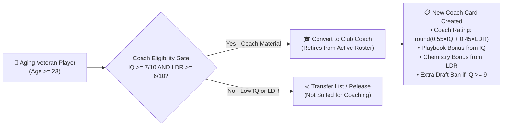

# Esports Clash: Chess.com × Hattrick Club Management Architecture

> **Status**: Proposed & Specified (2026-11-07)  
> **Scope**: Club Management UI/UX, **1–10 Attribute Scale**, **IQ & Leadership (`LDR`)**, **Veteran Player → Coach Conversion**, Hattrick Series & Cup Format, Weekly/Matchday Training System, Real-World Transfer Market & Live Bidding, Batch Player Generation Job, Scouting Network & Scout Attributes (`1–10`), Economy Cleanup (No Ads / No Gacha Packs / No Elo Rating Ladder), and Anti-Pay-to-Win Financial Fair Play.

---

## 1. Visual & UX Direction: Chess.com × Hattrick Hybrid

The interface combines **Chess.com's** tactile, friendly dark-wood/slate navigation and unmistakable 3D green primary action buttons with **Hattrick's** legendary football/esports club management tables, **1–10 skill bars**, training sliders, and live transfer bidding sheets.

### 1.1 Color & Surface Tokens (`--ht-*` / `--cc-*`)

| Element | Token | Hex / Value | Inspiration |
| :--- | :--- | :--- | :--- |
| **App Left Sidebar** | `--cc-sidebar-bg` | `#262421` | Chess.com dark walnut/charcoal sidebar |
| **Sidebar Hover / Active** | `--cc-sidebar-active` | `#363431` (left accent `#81b64c`) | Chess.com active nav pill |
| **Primary CTA Button** | `--cc-green-primary` | `#81b64c` (bottom lip `4px solid #537133`, hover `#95bb4a`) | Chess.com "Play" 3D tactile button |
| **App Canvas Background** | `--ht-canvas-bg` | `#ebecd0` / `#e4e7df` | Classic chessboard light-square / Hattrick pitch-tint stone |
| **Card / Panel Surface** | `--ht-panel-bg` | `#ffffff` & `#f8f9f5` | Clean, high-contrast paper dossier |
| **Panel Header (Club/Pitch)** | `--ht-header-bg` | `#1e5631` (accent `#2b6e3f`) | Hattrick classic pitch-green section banner |
| **Secondary Header (Slate)** | `--cc-header-slate` | `#302e2b` | Chess.com match/analysis header bar |
| **Skill Bar Fill (1–10)** | `--ht-skill-bar` | `#2d8a4e` → `#81b64c` → `#e6a817` | Hattrick 10-pip attribute bar (`1/10` to `10/10`) |
| **Bid / Money Highlight** | `--ht-gold` | `#d97706` / `#fef3c7` | Transfer market bid & wage highlight |
| **Alert / Outbid / Relegation**| `--ht-danger` | `#dc2626` / `#fee2e2` | Outbid warning & relegation zone |

### 1.2 The 1–10 Hattrick Attribute Scale & Verbal Descriptors
All player, scout, and coach attributes across the entire Club UI use a clean, immediately readable **1 to 10 scale** (`1/10` to `10/10`, with sub-level training progress `0%–100%` toward the next point), paired with Hattrick verbal descriptors:

| Score (`1–10`) | Hattrick Verbal Descriptor | Badge / Bar Color | Internal Sim Mapping (`1–99`) |
| :---: | :--- | :--- | :---: |
| **1 / 10** | *Non-existent* | `#9ca3af` (Grey) | `10–19` |
| **2 / 10** | *Wretched* | `#9ca3af` (Grey) | `20–29` |
| **3 / 10** | *Poor* | `#d97706` (Amber) | `30–39` |
| **4 / 10** | *Weak* | `#d97706` (Amber) | `40–49` |
| **5 / 10** | *Passable* | `#65a30d` (Olive Green) | `50–59` |
| **6 / 10** | *Solid* | `#16a34a` (Hattrick Green) | `60–69` |
| **7 / 10** | *Excellent* | `#15803d` (Deep Green) | `70–79` |
| **8 / 10** | *Formidable* | `#0284c7` (Pro Blue) | `80–87` |
| **9 / 10** | *World Class* | `#7c3aed` (Royal Purple) | `88–94` |
| **10 / 10** | *Divine (GOAT)* | `#ca8a04` (Championship Gold) | `95–99` |

> **Simulation Compatibility Note**: A deterministic converter (`toScale10` / `fromScale10`) maps between the user-facing `1–10` scale and the internal `1–99` simulation math so match physics and tests stay cleanly bridged.

### 1.3 Core 7 Player Attributes (`1–10` Scale)
Every athlete dossier displays **7 core attributes (`1–10`)**:
1. **Aim & Mechanics (`LAN`, `1–10`)**: Precision aim, recoil control, and first-bullet opening duels.
2. **Trading & Coordination (`TF`, `1–10`)**: 5v5 spacing, trade-fragging, crossfire positioning, and utility layering.
3. **Game Sense & Macro (`IQ`, `1–10`)**: Objective timing, map rotations, economy judgment, **and future Coach Tactical Playbook ceiling**.
4. **Leadership (`LDR`, `1–10`)**: Shotcalling, team morale aura, tilt prevention, **and future Coach Chemistry ceiling**.
5. **Clutch (`CLU`, `1–10`)**: Execution in high-pressure 1vX and late-round post-plant/defuse situations.
6. **Stamina (`STA`, `1–10`)**: Resistance to matchday fatigue and mental tilt.
7. **Flexibility (`FLX`, `1–10`)**: Ability to pilot secondary weapons and multiple tactical roles.

---

## 2. Veteran Players Becoming Coaches (IQ & Leadership Gate)

Just like Hattrick's iconic **Player-to-Coach conversion system**, aging veteran players do not simply become useless when their mechanical growth slows down — high-IQ leaders can transition into your club's **Head Coach** (or be hired onto your Coaching Staff)!

### 2.1 How IQ & Leadership Determine Coaching Future
1. **In-Field Captaincy (While Active Player)**:
   - Among your Starting Five, the player with the highest combined `LDR + IQ` is automatically designated **Team Captain (Shotcaller)**, granting a live morale/chemistry boost.
   -Player dossiers display a **"🎓 Future Coach Prospect"** badge whenever `IQ >= 7` and `LDR >= 6`.
2. **Eligibility to Become a Coach**:
   - **Age Requirement**: Player must be **Age `23+`** (Veteran tier, where physical `LAN`/`TF` training slows down).
   - **Attribute Requirement**:
     - **`IQ >= 7 / 10`** (*Excellent* Game Sense or higher)
     - **`Leadership (LDR) >= 6 / 10`** (*Solid* Leadership or higher)
   - **Conversion Fee**: Converting a veteran player into a Coach costs significantly less (`🪙 500–1,500` licensing fee) than hiring an external elite coach (`🪙 4,000+`), rewarding clubs that keep and mentor high-IQ, high-Leadership veterans!
3. **Coach Stats Derived from Player's `IQ` & `LDR` (`1–10`)**:
   - **Coach Overall Rating (`1–10`)**:
     $$\text{Coach Rating} = \text{round}(0.55 \times \text{IQ} + 0.45 \times \text{LDR})$$
   - **Playbook Bonus**: `+3%` per point of `IQ` above 5 (up to `+15%` at `IQ 10/10`).
   - **Chemistry Bonus**: `+3` per point of `LDR` above 5 (up to `+15` at `LDR 10/10`).
   - **Extra Draft Ban**: Unlocked if the player's `IQ >= 9/10` (*World Class / Divine* mastermind).
   - **Tactical Archetype**: Inherited from the player's primary FPS role & personality (e.g., IGL/Support with high `IQ` → *Structured Default*; Entry/Fragger → *Aggressive Execute*; AWPer/Lurker → *Pick & Map Control*).

---

## 3. Hattrick-Style Series Pyramid & Clash Cup (Replacing Ratings)

- **Removed**: `RankedLadderView`, `300+` Chess Elo rating numbers, Pawn-to-Grandmaster rating badges, and post-match Elo delta modals.
- **Replaced By — 4-Division Hattrick Series Pyramid + Clash Knockout Cup**:
  - **Series I (Global Premier)** · **Series II (Continental Elite)** · **Series III (National Pro)** · **Series IV (Regional Challenger)**.
  - **8 Clubs per Series · 14 Rounds (Double Round-Robin)**:
    - `3 pts` per win, `0 pts` per loss, sorted by **Points → Net Kill Differential (`K - D`) → Round Differential**.
    - All 4 fixtures in your 8-club Series resolve each round so the league table is a living ecosystem.
    - **Top 2 (Green Zone)** promote to the higher Series; **Bottom 2 (Red Zone)** relegate.
  - **Clash Knockout Cup**: 16-club single-elimination bracket (`Round of 16` → `Quarterfinals` → `Semifinals` → `Grand Final`) running parallel to the league split.

---

## 4. Hattrick-Style Training System (`1–10` Scale)

Instead of gacha duplicates, players develop through **Club Training Regimens** and **Match Experience**:
- **Primary Training Focus** (choose 1 active regiment):
  1. **Aim & Mechanics (`LAN`)**
  2. **Trading & Coordination (`TF`)**
  3. **Tactical Macro & Game Sense (`IQ`)** *(also helps groom future coaches!)*
  4. **Leadership & Shotcalling Workshop (`LDR` + `CLU`)**
  5. **Endurance & Conditioning (`STA`)**
  6. **Weapon & Role Flexibility (`FLX`)**
- **Training Intensity (`50%–100%`) & Stamina Share (`10%–30%`)**.
- **Slot & Age Multipliers**:
  - **Starters in Focus Role**: `100%` training speed.
  - **Other Starters**: `60%` training speed.
  - **Reserves**: `30%` scrimmage training speed.
  - **Age Curve**:
    - `16–18 yo` (Youth Prodigies): **`1.45×` training speed** toward their `potentialRating` (`1–10`).
    - `19–22 yo` (Prime): **`1.00×` training speed**.
    - `23+ yo` (Veterans): **`0.45×` physical training speed**, **`1.20×` `IQ` / `LDR` mentoring speed**, and **eligible for Coach Conversion** if `IQ >= 7` and `LDR >= 6`!

---

## 5. Real-World Transfer Market & Live Bidding System

- **Zero Gacha & No Ads**: Card packs (`PACK_CATALOG`, `PackOpeningModal`), duplicate card merging, rewarded ads, and daily supply drops are completely removed.
- **Open Transfer List & Live Bidding**:
  - Filter players by Role, Age (`16–27`), Minimum `1–10` Skill (`LAN`, `TF`, `IQ`, `LDR`, `CLU`, `STA`, `FLX`), Future Coach Eligibility (`IQ >= 7 & LDR >= 6`), and Max Price.
  - Each listing displays **Seller Club**, **Asking Price**, **Current Highest Bid & Bidder**, **Release Clause (Instant Buyout)**, **Weekly Wage**, and **Deadline Countdown**.
  - **Escrow & Outbid Refund**: Active highest bids lock funds in escrow; if an AI club outbids you, your coins immediately return to available cash.
  - **Sell Your Own Players**: List any reserve player on the open Transfer Market with custom Asking Price & Release Clause.

---

## 6. Batch Player Generation Job & Scouting Network (`1–10` Scale)

### 6.1 Batch Player Generator Job (`EsportsClash.Api` + `marketBatchEngine.ts`)
- **Backend Job**: `App\Jobs\GenerateTransferMarketBatchJob` + Artisan command `php artisan esports:generate-player-batch` + API endpoint `POST /api/v1/market/batches/generate`.
- **Client/Standalone Engine**: `src/marketBatchEngine.ts` generates a cohort of `24` new players per batch cycle:
  - **60% Public Market Intake**: `19–26 yo` players (including high-`IQ`/high-`LDR` veteran leaders who can be signed and converted into future coaches) placed directly on the Transfer Market.
  - **40% Regional Youth Pools**: `16–19 yo` hidden prodigies (`5/10–7/10` current rating, `8/10–10/10` Potential ceiling) placed into regional scouting pools (`LCK`, `LPL`, `LEC`, `LCS`, `Challengers`).
  - Strictly enforces fictional gamer parody handles (`AGENTS.md`).

### 6.2 Scouts & Scout Attributes (`1–10` Scale)
Each Scout (`ScoutCard`) has **6 attributes on the `1–10` scale**:
1. **`judgingAbility` (`1–10`)**: Accuracy of revealed current `1–10` stats (low skill shows a fog-of-war range like `5–8/10`; `9–10/10` reveals exact `7/10` ratings).
2. **`judgingPotential` (`1–10`)**: Accuracy in revealing the prospect's hidden `potentialRating` (`1–10`).
3. **`regionalKnowledge` (`1–10`)**: Bonus discovery rate in the scout's home region (`LCK`, `LPL`, `LEC`, `LCS`, `Challengers`).
4. **`roleExpertise` (`1–10`)**: Higher prospect quality in the scout's specialized role.
5. **`negotiation` (`1–10`)**: Up to `25%` discount on prospect signing fees and weekly wages.
6. **`networkReach` (`1–10`)**: Number of prospect dossiers (`2–5`) delivered per batch.

---

## 7. Anti-Pay-to-Win Economy & Financial Fair Play (FFP)

1. **Division Reputation Cap (FFP)**:
   - Lower divisions have a signing ceiling on established open-market stars (`Series IV`: max `8/10` Rating; `Series III`: max `9/10`; `Series II & I`: up to `10/10`).
   - Extra Club Funds **cannot buy a full `10/10` team in Series IV** — you must invest in **Scouts**, **Training Facilities**, **high-potential Youth Prodigies (`6/10` now → `10/10` Potential)**, and **high-IQ/LDR Veteran Mentors**!
2. **Split-Capped Board Capital Grants**:
   - Optional Club Treasury boosts (`+🪙 2,500` / `+🪙 5,000` Coins) are capped at **max 2 grants per 14-round Season Split**, alongside a cosmetic/QoL **Supporter Pass**.
