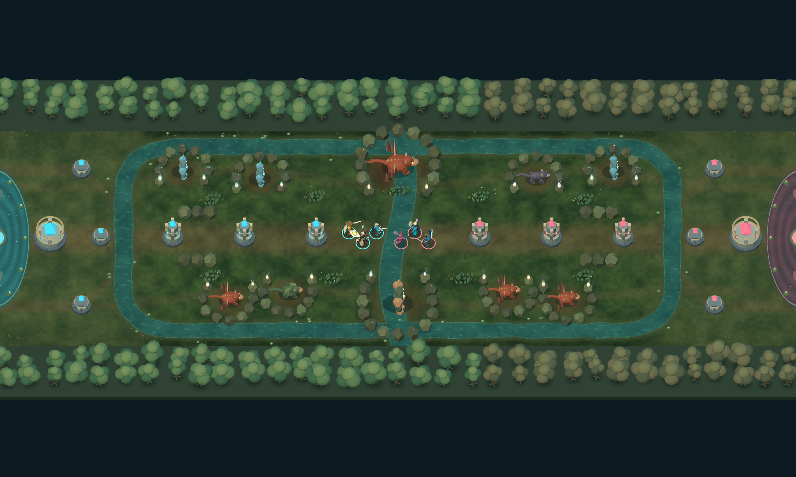

# Open swamp map revision — 2026-10-18

Historical design/evidence: superseded by the user's second annotated map and the implementation in [stone-sanctuary-map.md](stone-sanctuary-map.md). The screenshots and passing checks below apply only to this earlier revision. Testing of the replacement is explicitly deferred by the user.

The perimeter marks are shallow water; the six circles are barracks. The map now uses broad natural bases with north, middle and south barracks, large healing groves, open earth trails and a swamp around the jungle. The bridge, fitted paving and center plaza are removed.



The arena keeps its 2600x760 coordinates and single lane. Water crosses the lane naturally without requiring a bridge, slow or new navigation exception. Real camp banks and entrances remain visible/collidable. Reeds, lilies, roots, mushrooms, crystals, braziers and distinct neutral shapes identify camps. Ground clearings use soft shader blending rather than fitted floor tiles.

| Layout | Blue | Red |
| --- | --- | --- |
| Melee barracks | (330,140) | (2270,140) |
| Ranged barracks | (390,380) | (2210,380) |
| Catapult barracks | (330,620) | (2270,620) |
| Well center | (65,380) | (2535,380) |
| Well ellipse radii | 105x240 | 105x240 |

Creeps spawn from matching real barracks and walk toward a clear base rally point before joining the central lane. Live minion acquisition checks both axes. IDs, HP, empowerment, wave timing, speed and Nexus seals are preserved. Side routes change wave arrival timing; full live-match pacing/balance remains unverified.

The larger healing ellipse is shared by healing, shopping, recovery and team calls; headless healing uses it too. Its forward edge remains behind the Nexus. Enemy well beams retain their existing boundary/damage and unsafe chases still pass through safety checks. No forced dive-abort subsystem was restored.

Implementation: `arenaLandform.ts`, `arenaLayout.ts`, `baseSafetyRules.ts`, `components/AramMatchView.tsx`, `matchSimulationEngine.ts`, `threeArenaTerrain.ts`, `threeArenaScenery.ts`, `threeArenaScene.ts`, layout/scenery/terrain tests and `scripts/review-map-detail.mjs`. The review script now accepts `OUTPUT_PREFIX` and uses six real barracks and actual camp types, preserving older evidence.

Verification:

- `npm.cmd run check:game`: 434 tests, three deterministic simulation checks and TypeScript pass (`swamp-map-check-game.log`).
- `npm.cmd run build`: passes with existing chunk-size/plugin-timing advisories (`swamp-map-build.log`).
- Layout tests check mirrored structures, actual initialization/class spawning, collision-free normal-speed routes, water crossings and larger well bounds that leave Nexus finishing legal. Neutral instance cleanup/borrowed-clock tests pass.
- Four native Three views: [overview](swamp-map-after-overview.png), [base](swamp-map-after-blue-base.png), [center](swamp-map-after-river.png), [Dragon pit](swamp-map-after-dragon-pit.png). `swamp-map-after-verification.json` records shader compilation, unchanged inputs, exact paused/rewound pixels and disposal. Scenery has 4,762 instances in 53 batches and 602 particles in six draws. Neutral geometry also uses per-surface instances; overview draw calls dropped from 802 to 527 during the batching correction. These fixture counts are not device-performance claims.
- `swamp-map-final-verification.json` records the final GLB-required live 3D/2D audit: identical state/RNG/execution at 30/60/90 seconds, three viewport layouts, mouse/touch pan, minimap navigation, context loss/recovery and disposal. `swamp-map-verification.json` preserves the preceding audit. Final screenshots use `swamp-map-final-`.

Reproduce with local Vite on 5198 and disposable headless Chrome CDP on 9248, then from `EsportsClash.Web`:

```powershell
$env:VITE_PORT='5198'; $env:CDP_PORT='9248'
$env:OUTPUT_PREFIX='swamp-map'
node scripts/review-map-detail.mjs
$env:OUTPUT_PREFIX='swamp-map-final'; $env:REQUIRE_GLB='1'
node scripts/check-arena-3d.mjs
```

All art is original procedural code; no Valve assets or external downloads. Camp meshes are runtime art rather than new GLBs. Texture/animation polish, the avatar rework queue, deferred 5v5 polish, full live-match balance and physical-device performance remain separate work. Other documented headless ability/AI simplifications remain. No ML candidate was retrained or promoted; historical studies do not validate revised-map performance. Default mute and Arsenaldo's imported animation preference remain intact.
